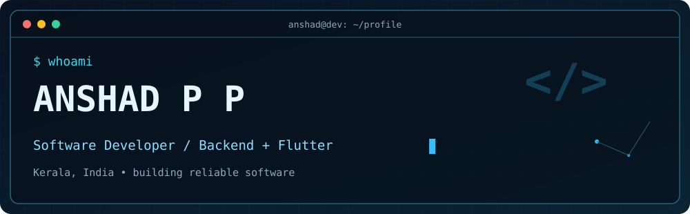

<div align="center">



<a href="https://git.io/typing-svg"></a>

[](https://anshadpp.github.io/portfolio)
[](https://linkedin.com/in/anshad-p-p)
[](mailto:anshad.pp36@gmail.com)

</div>

## `> whoami`

```yaml
name: Anshad P P
role: Software Developer
location: Kerala, India
current_company: Zabnix Private Limited
focus:
  - Enterprise ERP applications
  - Flutter and backend engineering
  - Debugging and performance optimization
learning:
  - C/C++ fundamentals
  - Systems programming concepts
```

I develop enterprise applications, backend services, and cross-platform software. Currently, I work on an ERP product for pharmaceutical retail and wholesale operations using **Flutter, Dart, NestJS, and PostgreSQL**. I enjoy diagnosing software problems, improving performance, and building maintainable systems.

## `> cat experience.log`

**Software Developer — Zabnix Private Limited** · Jun 2026–Present  
Working on pharmaceutical retail and wholesale ERP software, including inventory, purchasing, sales, accounting, and reporting workflows. Building Flutter features, integrating NestJS APIs and PostgreSQL, and investigating performance and integration issues.

**Junior Full Stack Developer — Incube Innovation Incubator LLP** · Jul 2024–May 2026  
Built Java/Spring Boot services and Flutter applications, including **50+ REST API endpoints** for a football academy platform. Worked with MySQL, authentication, AWS S3, Firebase Cloud Messaging, and Linux deployments. Promoted from trainee in Aug 2025.

**Junior Full Stack Developer (Contract via Incube) — Travel360** · Mar–May 2026  
Contributed to an early-stage travel marketplace MVP using TypeScript, Node.js, Hono.js, and React.

## `> ls ./toolbox`

**Languages**  
    

**Frameworks & platforms**  
    

**Data, infrastructure & tools**  
    

**Currently learning:** C and C++ fundamentals, systems programming concepts.

## `> tree ./projects`

```text
projects/
├── daily-tracking/       # Offline-first Android planning app
└── portfolio/            # Interactive React developer portfolio
```

**[Daily Tracker](https://github.com/anshadpp/daily-tracking)** — Flutter, Dart, SQLite. Offline task planning, reminders, progress statistics, and local storage.

**[Personal Portfolio](https://github.com/anshadpp/portfolio)** — React, TypeScript, Vite, Tailwind CSS. Interactive portfolio with motion effects and accessibility considerations. **[Live site](https://anshadpp.github.io/portfolio)**.

> Professional ERP and client projects are described at a high level; their source code is not shared here.


<h2>📊 GitHub Activity</h2>

<div align="center">


</div>


<sub>GitHub statistics reflect public repository activity, not total professional experience. External widgets may be temporarily unavailable.</sub>

---

<div align="center">

<br />
<sub>Thanks for visiting · <a href="https://anshadpp.github.io/portfolio">Explore my portfolio</a></sub>
</div>
